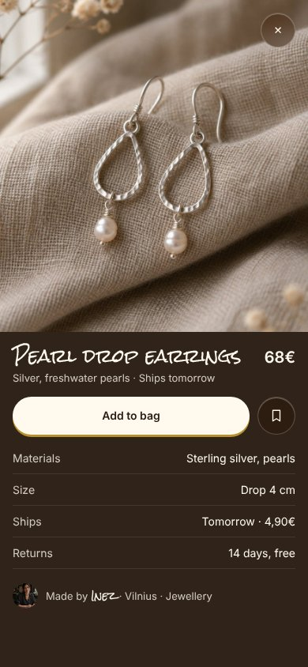
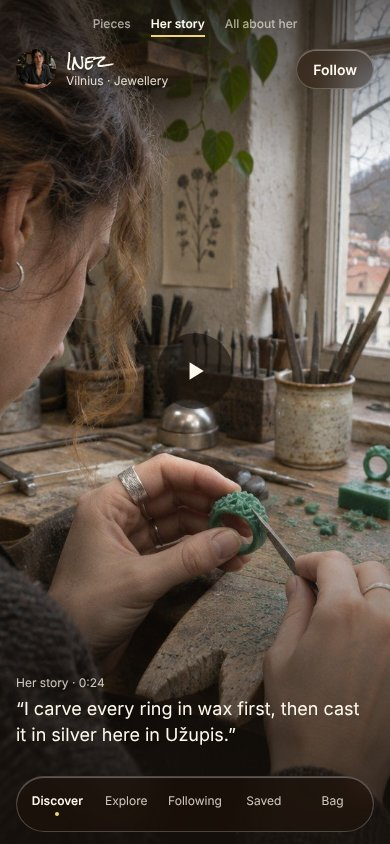
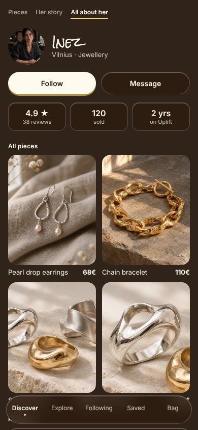
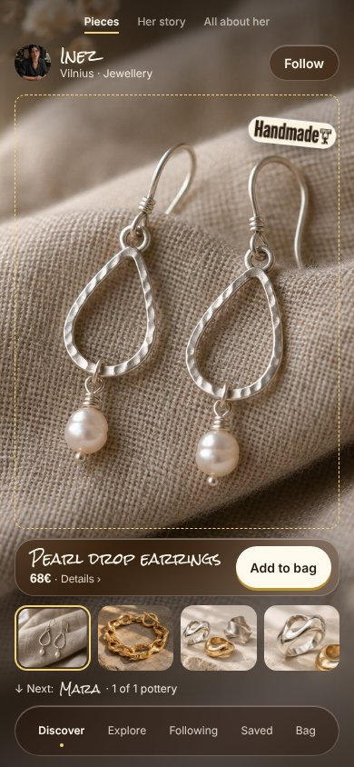
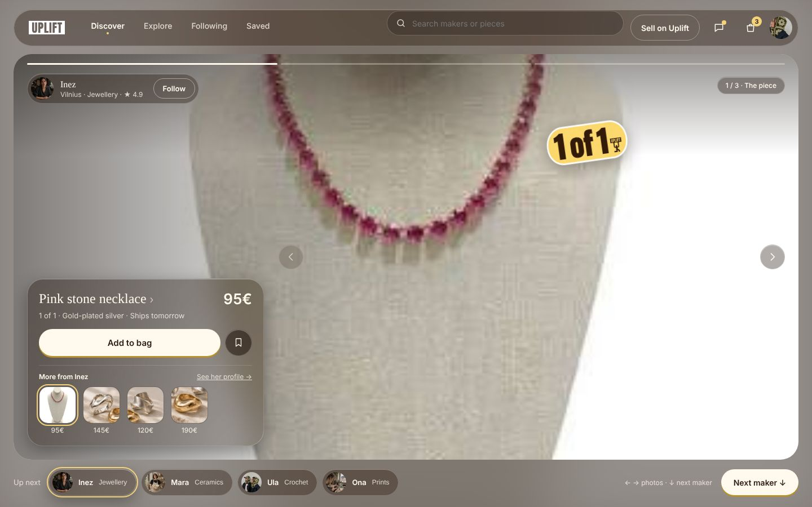

# Discover v3 + the new rules (decided by Matas, 2026-11-25)

**Read this first before touching Discover, any photo screen, any button, icon or nav.** It replaces the old Discover in `HANDOFF-07.md` (3 sideways panels with the big glass card). Everything here is also in `docs/ai/FIXES.md` (P6.10, P7, P8, P9) as tasks, and in `docs/ai/QUALITY.md` as standing rules. If something here and an older doc disagree, this file wins.

Trumpai (LT): telefone vienas kūrinys per visą ekraną ir siaura juosta apačioje. Šonu brauki giliau į kūrėją (kūriniai → istorija → viskas apie ją), žemyn rodo kitą kūrėją. Kompe vienas kūrinys didelėje nuotraukoje, viskas kita kortelėje dešinėje. Produktas visada saugioje zonoje, viskas tiksliai centre, ikonos tik SVG.

---

## 1. Phone Discover (390×844)

| Pieces | Details (tap title) | Her story (swipe ←) | All about her (swipe ←) |
|---|---|---|---|
|  |  |  |  |

Spec (clickable): `screens/03-discover-v3.dc.html`. References use the real Rock Salt font.

### 1.1 The logic: the more interested you are, the deeper you go

1. **Pieces** (what you land on): one piece full screen, sticker, the bar (title, price, Add to bag), 4 more of her pieces, "↓ Next: Mara · 1 of 1 pottery".
2. **Details** (tap the title): photo, title + price, Add to bag + save, facts (materials, size, ships, returns), "Made by Inez". Product only, nothing about her story here.
3. **Her story** (swipe ← from Pieces): her video, one quote.
4. **All about her** (swipe ← again): avatar, Follow + Message, 3 stats, all pieces grid, a review, "Up next" card.

### 1.2 Gestures (every gesture always means the same thing)

| Gesture | Does |
|---|---|
| Swipe **up / down** | next / previous maker. Snap, one maker per swipe (`scroll-snap-stop: always`). |
| Swipe **sideways** | deeper into the same maker: Pieces → Her story → All about her. Snap per panel. Discover is a root tab, so there is no clash with iOS edge-swipe-back. |
| **Tap** a small piece | it becomes the big piece (photo, title, price, sticker, details switch; 250ms cross-fade). You stay on Pieces. |
| **Tap** the title | Details slides up full height. ✕, Back, edge-swipe and swipe-down close it and return to the exact same piece and photo. |
| **Tap** avatar / name | jump to All about her. |
| **Add to bag** | never moves you anywhere. Button → "In your bag ✓", bag count pops. (Flip, a closed "TikTok for shopping" app, lost users by auto-scrolling after taps. Don't.) |

**Sideways must feel like one continuous screen, not a new page (2026-11-25 17:00, FIXES P10.1):**
- Tabs, the maker row (avatar, name, Follow) and the nav are **one fixed layer** above the panels. They never move during a sideways swipe; only the content under them moves. One copy of them per maker, not one per panel.
- The tab underline follows the finger live: its x and width are interpolated from `scrollLeft / panelWidth` on every scroll frame, not set when the snap ends.
- Parallax: the panel being left moves at 0.3× the finger and darkens to 60% (black overlay 0 → .4). The incoming panel slides over it with a shadow on its leading edge (`-12px 0 24px rgb(0 0 0 / .35)`). No hard seam between two different photos.
- Snap stays native CSS (`scroll-snap-type: x mandatory`, `scroll-snap-stop: always`) so momentum feels like iOS. Parallax only with `transform`/`opacity`, driven by scroll (scroll-driven animations or one rAF reading `scrollLeft`). Reduced motion: no parallax, no darkening, same snap.
- **P11.2 (22:30): it must always land on a panel.** Matas: "you can stop it in the middle, it moves only as far as your finger, laggy". Whatever was added for P10.1 must not take over the scroll: no JS writing `scrollLeft`/`transform` on the scroller while the finger is down, no `scroll-snap-type: none` or `proximity`. Release anywhere → it finishes the move to the nearest panel (or the next one if the flick went that way). No panel may ever rest half on screen.

Patterns are borrowed, not invented: TikTok/Reels (up = next), Instagram Stories / Tinder (tap to browse), Depop/Vinted ("more from this seller" right next to the item), NN/g bottom-sheet guidance (sheets short, ✕ + back close them, never stack).

### 1.3 No hint texts, use motion

- No "Swipe ← …" labels anywhere.
- First visit only: 1.2s after Discover opens, the panels bounce left (−64px, back, −18px, back, 1.6s total) so the next panel peeks out. Reduced motion: no bounce.
- Tabs at the top ("Pieces · Her story · All about her", **centred** like TikTok, active = 600 weight + 2px butter underline) show where you are.

### 1.4 Layout (one 16px grid; nothing may be off it)

- Side margin **16px** for every element: tabs, maker row, sticker, bar, thumbs, next line, details page, profile panel.
- Top: tabs at top 16 (centred) → 12 → maker row (avatar 40, name Rock Salt 17, meta 12, Follow pill 40 high).
- Bottom, from the bottom: nav 12–66 → 12 → "Next" line 16 high → 12 → thumbs row 72 high → 10 → bar 64 high.
- **Thumbs:** 4 exactly equal tiles, 8px gaps, row edges = bar edges. Selected = 2px butter ring drawn **inside** the tile (image scales to 90%), so no tile looks bigger or shifted.
- **Bar ("the bubble"):** glass (`.g`), radius 22, height 64, padding 8 8 8 16. Line 1: title in Rock Salt 16, **always the full title, never an ellipsis**. Line 2: "68€ · Details ›" (price 600 14px, rest 12px). Right: Add to bag, 46px, cream with the hard bottom edge.
- **Title length:** Studio "Add piece" title field has a hard limit of **20 characters** with a live counter ("19/20"). Shorten longer titles in the data.
- Sticker: right 16, top 128, 104px wide, rotated 6°. Shadow `drop-shadow(0 2px 6px rgb(0 0 0 / .25))` on the **wrapper**, never on the `` (iPhone Safari clips a filter on an img to the img's box, which made the cut-off dark rectangles). Same rule for every sticker on the site.
- **End of the feed** ("You've met everyone for now", P10.4): layout stays as built; only the title gets `line-height: 1.15` so the second line ("now") sits close under the first.
- Details page: photo 420px, padding 16, title Rock Salt 22 + price 20/600, Add to bag 48 + save 48, fact rows 14px with a 1px line.

### 1.5 Product safe zone

- The product must never sit under the bar/thumbs (bottom) or the tabs/maker row (top).
- Tokens in `app/globals.css`: `--u-safe-top:104px`, `--u-safe-bottom:262px`, 16px sides → zone x 16–374, y 104–582.
- **Changed again 2026-11-25 22:30 (Matas, FIXES P11.1). This is the rule now; P10.2 is cancelled.** The photo is **full screen, never shrunk, never framed by a blur**, exactly like the reference above. The product lands in the safe zone because the photo itself is made for the screen: every piece has a **tall 9:16 hero** (`public/img/tall/<name>.jpg`, same photo with more background above and below) for the phone and a **wide 4:3 hero** (`public/img/wide/<name>.jpg`) for the desktop.
- Phone placement (no blur layer at all): `object-fit: cover; position:absolute; left:0; width:100%; top: calc(var(--u-safe-top) - var(--u-safe-bottom)); height: calc(100% + var(--u-safe-bottom) - var(--u-safe-top))`. That puts the photo centre at the centre of the safe zone (y 343 on 390×844) on every screen height, with photo above and below to fill the whole screen.
- Studio later (Supabase): when a maker uploads a photo, the server makes the tall and wide versions (AI outpaint, same as these) and shows them for approval with the safe-zone frame. Until then the mock uses the files from `scripts/fetch-hero-photos.mjs`. Pieces without a tall/wide hero use the normal photo with the same placement.
- Any future screen with UI over a product photo follows the same rule. If you move an overlay, recompute the tokens so the zone ends 8px before it.

---

## 2. Desktop Discover (≥ 820px)

Spec: `screens/desktop/03-discover.dc.html`.

- Left: **one big photo of the current piece only**, cover, radius `--u-r-card`. Nothing over it except one sticker, ← → buttons and dots for **this piece's photos**.
- Right: 400px glass card: maker row (avatar 52, name Rock Salt 22, city · category · rating, Follow) → title (Rock Salt 26) + price → meta → Add to bag + save → "Watch Inez at work" video row → "More from Inez" (4 thumbs; click = becomes the big piece) + "Her profile →" → "Next maker · Ceramics / Mara · Scroll ↓" pinned at the bottom.
- Wheel / ↓ = next maker. ← → keys = this piece's photos.
- **Changed 2026-11-25 22:34 (Matas, FIXES P11.3): one maker per scroll on desktop too.** Not free scrolling like a shop: a wheel flick, trackpad swipe, ↓ or PageDown moves exactly one maker, and the page always stops with one maker filling the screen. This replaces Justinas's free scrolling from P7 (Matas asked for it; tell Justinas).
- Desktop photo: the wide 4:3 hero, `object-fit: cover`, centred. The piece is never cut by the frame (Matas's screenshot: the granny bag was cropped top and bottom).
- **Removed on desktop:** the 3-panel sideways strip (piece → video → profile) and the glass card floating over the photo. Note: commit 567a6bd (11:37) sped up the old 3-step arrows; that strip goes away with P7.

---

## 3. Rules for the whole site (also in `docs/ai/QUALITY.md` 2.1)

### 3.1 Everything optically centred (±1px, `node scripts/qa.mjs` checks it)
- Icons are SVG from one `components/u/Icon.tsx` (24×24 viewBox, drawn centred). Never text characters as icons: no `✕ × › ‹ → ← ↓ ↑ ▲ ▶ ★ ☆ ✓ +` as the content of a button, chip or circle. Arrows inside running text ("Her profile →") may stay text.
- Indicators (active dot, badge, count) are `position:absolute`, so they never push a label off centre. Bottom nav dot sits at `bottom:9px`; the label stays at the exact vertical centre of the pill.
- Rows of labels in a pill (bottom nav, tabs, segmented controls) use `justify-content:space-evenly` on the labels' own widths: same space before the first label, between labels and after the last. Tap area grows with `::after`, not `min-width`.
- Single-line labels in fixed-height controls use `line-height:1`.

### 3.2 Photos
- Every product photo ≥ 1200px wide, 4:5, the product itself first. New Higgsfield set: branch `matas/new-photos`, FIXES P8.
- One badge per frame (one sticker; no chip repeating it).

### 3.3 Before you say "done"
Follow `docs/ai/QUALITY.md`: `node scripts/qa.mjs` with 0 FAIL, your screenshots next to the references above, use it by hand at 390×844 **and in iPhone Safari** (toolbar shown and hidden) and at 1440×900, fix and repeat.

## 4. Order of work
P6–P11 are done (P11, 2026-11-25: tall/wide heroes, sideways always lands on a panel, desktop one maker per scroll; waits for Matas's iPhone + computer test). One PR per part, QUALITY loop each time, tick the boxes in FIXES.md.
